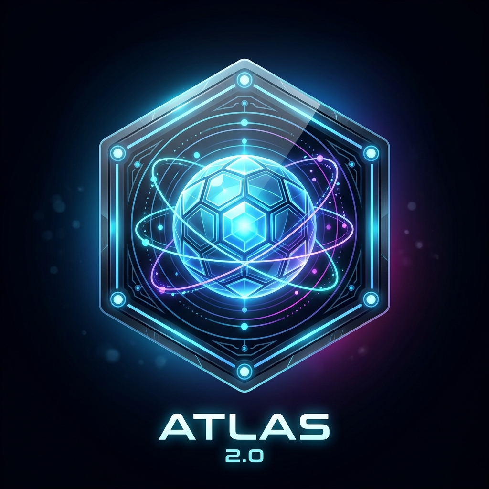

# 🛰️ ATLAS 2.0 — Autonomous Desktop AI Assistant & Automation Engine

<div align="center">



### *Next-Generation Autonomous Desktop Companion with Biometric Voice Lock, 3D Cellular Visualizer & Multi-LLM Orchestration*

[](https://www.python.org/)
[](https://fastapi.tiangolo.com/)
[](https://threejs.org/)
[](https://github.com/resemble-ai/Resemblyzer)
[](https://github.com/rany2/edge-tts)
[](https://www.sqlite.org/)
[](https://microsoft.com/windows)

</div>

---

## 📖 Overview & Vision

**ATLAS 2.0** is built from the ground up to solve the architectural constraints of the original ATLAS project. Designed with high modularity, zero-latency execution, and non-blocking asynchronous concurrency, ATLAS 2.0 acts as an autonomous desktop companion that operates both locally on your machine and remotely via Telegram.

ATLAS combines a minimalist, cyberpunk-inspired visual interface centered around a **3D cellular organic rotating blob** with a hybrid intelligence pipeline: **near-instant native execution (<120ms)** for hardware and OS automations, coupled with **multi-provider LLMs** (Gemini, OpenRouter, FreeLLMAPI, Ollama) for open-ended reasoning.

---

## ✨ Core Features

### 1. 🪐 3D Cellular Rotating Blob Visualizer
- Powered by **Three.js** and WebGL with harmonic 3D vertex noise displacement and a cybernetic cellular lattice.
- Clean and distraction-free main screen with only the central blob and a glowing status indicator bar.
- **Dynamic State Reactivity**:
  - 🔵 **IDLE**: Gentle breathing pulsation and steady celestial rotation.
  - 🟢 **LISTENING**: Real-time microphone audio amplitude waveform injection.
  - 🟡 **PROCESSING**: High-speed multi-axis gyroscopic rotation and energetic deformation.
  - 🟣 **SPEAKING**: Frequency ripple pulses synchronized with neural voice output.
  - 🔴 **ACCESS DENIED**: Deep crimson flare when an unrecognized speaker is detected.

### 2. 🎛️ Expandable Quick-Toggles (Top-Left)
A sleek glassmorphic panel on the top-left that slides open with a single click:
- **Brain Mode**: Toggle instantly between `AI Brain` (LLM-driven) and `Predefined Actions` (Native rules).
- **Listening Mode**: Enable or disable continuous background voice recognition.
- **Voice Output**: Toggle spoken neural TTS audio on or off.

### 3. 🛡️ Resemblyzer Biometric Voice Lock
- Utilizes deep learning speaker verification via **Resemblyzer** (d-vector voice embeddings).
- **Voice Enrollment Studio**: Record 3 short speech samples to create and persist your biometric voice profile (`voice_profile.npy`).
- **Strict Verification Gate**: Evaluates cosine similarity of incoming audio against your enrolled voice vector. Rejects commands from unauthorized speakers with an immediate *"Access Denied"* visual and audio feedback.

### 4. 🧠 Multi-Provider LLM Hub
- **Supported Providers**:
  - **Google Gemini**: Direct integration with `gemini-1.5-flash`, `gemini-1.5-pro`, etc.
  - **OpenRouter**: Access to DeepSeek-V3, Claude 3.5, Llama 3, and free community endpoints.
  - **FreeLLMAPI / OpenAI-Compatible**: Custom base URLs and API keys.
  - **Local Ollama**: Offline private models (`llama3`, `mistral`, `qwen`).
- **Ping & Validity Check**: Test connection status with a single click in Settings.
- **Editable System Prompt**: Modify ATLAS's personality, behavior, and capabilities directly within the app.

### 5. 🔊 High-Fidelity Neural TTS (Edge-TTS)
- 100% free, natural-sounding voice output powered by Microsoft Neural Voices.
- Popular presets included: *Christopher* (Deep & Confident Male), *Guy* (Energetic US Male), *Jenny* (Professional US Female), *Sonia* (Crisp British Female), *William* (Natural Australian), etc.
- Custom speech speed (`-20%` to `+30%`) and pitch adjustments (`-5Hz` to `+5Hz`) with live sample previews.

### 6. 📱 Telegram Remote Bot Bridge
- Control ATLAS from anywhere via your smartphone using Telegram.
- Execute system commands, query information, or request computer status remotely.
- Protected by token authentication and an optional **Chat ID Whitelist** to ensure only you have remote access.

### 7. 📜 SQLite Audit Logging
- Every command, execution route, recognized speaker score, latency, and status is logged to a local SQLite database (`data/atlas_logs.db`).
- Searchable and clearable audit log viewer directly inside the Control Center.

---

## ⚡ Predefined Command Catalog

ATLAS 2.0 provides instant execution for routine system actions without waiting for an LLM round-trip:

| Category | Voice / Text Command Examples | Action Executed |
| :--- | :--- | :--- |
| **Power Control** | `"shutdown"`, `"power off"` | Initiates Windows safe shutdown sequence |
| **Power Control** | `"cancel shutdown"`, `"abort shutdown"` | Cancels pending shutdown (`shutdown /a`) |
| **Power Control** | `"restart"`, `"reboot"` | Reboots the system |
| **Power Control** | `"lock computer"`, `"lock screen"` | Instantly locks Windows workstation |
| **Power Control** | `"sleep"`, `"put pc to sleep"` | Puts the system into sleep mode |
| **Window Management** | `"clear all apps"`, `"hide windows"` | Clears and minimizes all open applications |
| **Window Management** | `"show desktop"`, `"minimize all"` | Shows desktop (`Win + D`) |
| **App Launching** | `"open chrome"`, `"launch code"`, `"open spotify"` | Fuzzy launches any installed application |
| **App Closing** | `"close chrome"`, `"exit notepad"` | Gracefully terminates target application |
| **Volume Control** | `"volume up"`, `"louder"` | Increases Windows master volume |
| **Volume Control** | `"volume down"`, `"quieter"` | Decreases Windows master volume |
| **Volume Control** | `"mute"`, `"unmute"` | Toggles Windows audio mute |
| **Diagnostics** | `"system status"`, `"cpu usage"`, `"ram usage"` | Reports live CPU %, RAM %, and battery metrics |

---

## 📂 Project Architecture

```
ATLAS-2.0/
├── backend/
│   ├── app.py                  # FastAPI application & real-time WebSocket hub
│   ├── config.py               # JSON configuration manager (persisted settings)
│   ├── database.py             # SQLite audit logging database
│   ├── requirements.txt        # Backend dependencies
│   └── core/
│       ├── actions.py          # Windows automation (PyAutoGUI, Psutil, shell)
│       ├── engine.py           # Central dispatch engine & execution pipeline
│       ├── llm_hub.py          # Multi-LLM connector & ping validator
│       ├── tts_service.py      # Edge-TTS voice synthesis engine
│       ├── voice_biometrics.py # Resemblyzer speaker verification & embedding
│       └── telegram_bot.py     # Telegram Bot remote bridge
├── frontend/
│   ├── index.html              # Cyberpunk / glassmorphism main interface
│   ├── css/
│   │   └── style.css           # Styling, animations, glowing states, modals
│   ├── js/
│   │   ├── blob3d.js           # Three.js 3D cellular organic rotating blob
│   │   ├── app.js              # State coordinator, speech recognition & WebSocket
│   │   └── settings.js         # Settings drawer, enrollment wizard, log viewer
│   └── assets/
│       ├── logo.png            # AI-generated hexagonal ATLAS 2.0 emblem
│       └── atlas.ico           # Windows application icon
├── data/
│   ├── atlas_logs.db           # SQLite database file
│   ├── config.json             # Runtime configurations & saved API keys
│   ├── server.log              # Background server operational log
│   └── voice_profile.npy       # Enrolled Resemblyzer voice embedding
├── atlas_silent.vbs            # Silent VBScript launcher (zero terminal window)
├── main.py                     # Desktop application launcher (standalone app window)
└── run_atlas.bat               # Windows batch runner
```

---

## 🚀 Installation & Setup

### Prerequisites
- **Operating System**: Windows 10 or Windows 11 (64-bit)
- **Python**: Version 3.12 or 3.13
- **Microphone**: Any functional USB or built-in microphone

### Quick Setup

1. **Clone or Open the Repository**:
   ```powershell
   cd c:\Users\USER\OneDrive\Desktop\ATLAS-2.0
   ```

2. **Initialize Environment & Install Dependencies**:
   ```powershell
   # Create virtual environment
   py -m pip install uv
   uv venv .venv
   
   # Install dependencies
   uv pip install -r backend\requirements.txt
   ```

3. **Launch ATLAS 2.0**:
   - **Via Desktop Shortcut**: Double-click **`ATLAS 2.0`** on your desktop.
   - **Via Batch Script**: Double-click `run_atlas.bat` or run:
     ```bat
     run_atlas.bat
     ```
   - **Via Python Directly**:
     ```powershell
     .\.venv\Scripts\python.exe main.py
     ```

---

## 🖥️ Running in Desktop Application Mode

ATLAS 2.0 automatically runs as a **chromeless, borderless standalone desktop application window** powered by Microsoft Edge or Google Chrome app mode (`--app=http://127.0.0.1:8000`).

- **No browser tabs, no URL bar, no clutter**.
- Dedicated taskbar presence with the custom **ATLAS 2.0 icon**.
- The background server starts automatically and writes operational logs silently to `data/server.log`.

---

## 🔒 Voice Enrollment Walkthrough

1. Click the **Floating Logo Button** in the top-right corner to open the Control Center.
2. Under the **Voice Security** tab:
   - Click **`🎙️ Record Sample (0/3)`** and speak clearly for 3–5 seconds (e.g., *"Atlas activate system"*).
   - Repeat for samples 2 and 3.
   - Click **`Enroll Voice Profile`** to compute your 256-D d-vector embedding.
3. Toggle **Enforce Voice Lock** to `ON`.
4. ATLAS will now analyze incoming voice commands with Resemblyzer and only execute when the voice matches your enrolled profile.

---

## 🤖 Open-Source Ecosystem & Repositories Used

ATLAS 2.0 is built on top of high quality, free and open-source software:

- **[Resemblyzer](https://github.com/resemble-ai/Resemblyzer)**: Deep learning voice embeddings and speaker identification.
- **[edge-tts](https://github.com/rany2/edge-tts)**: High-fidelity Microsoft Azure Neural Voices without API keys.
- **[Three.js](https://threejs.org/)**: 3D WebGL computer graphics library for the cellular organic visualizer.
- **[FastAPI](https://fastapi.tiangolo.com/) & [Uvicorn](https://www.uvicorn.org/)**: Asynchronous backend server and WebSocket message broker.
- **[PyAutoGUI](https://github.com/asweigart/pyautogui)** & **[Psutil](https://github.com/giampaolo/psutil)**: Desktop input automation and hardware performance tracking.
- **[python-telegram-bot](https://github.com/python-telegram-bot/python-telegram-bot)**: Pure Python asynchronous Telegram Bot API wrapper.

---

## 📄 License
This project is open-source and available under the **MIT License**.
