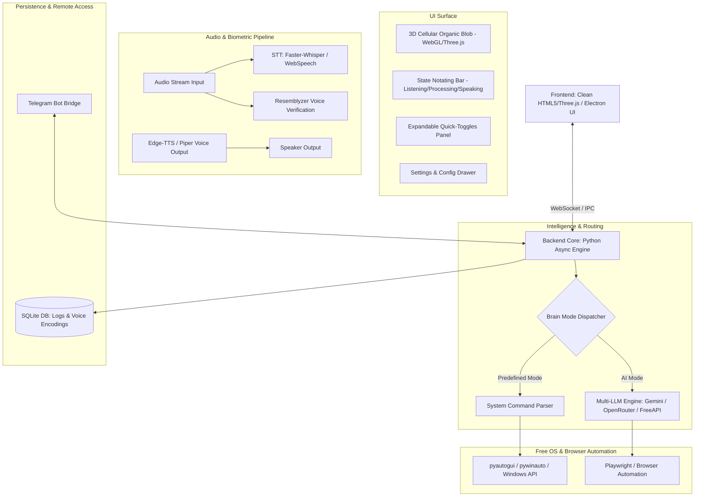
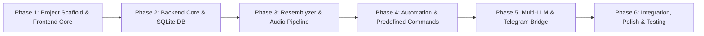

# ATLAS 2.0 — Product Requirements Document (PRD)

---

## 1. Executive Summary & Vision

**ATLAS 2.0** is a next-generation, modular desktop AI assistant built to supersede the original ATLAS project. Designed with high performance, modular architecture, and zero-latency responsiveness in mind, ATLAS 2.0 serves as an autonomous desktop companion capable of voice interaction, speaker verification, OS-level automation, web manipulation, and remote command processing via Telegram.

### Core Objectives
- **Minimalist, High-Tech Interface**: Clean aesthetic focused on a 3D cellular rotating animated blob, minimal distraction, and responsive state indicators.
- **Biometric Voice Lock (Resemblyzer)**: Protect execution by verifying the owner's voice embeddings so the assistant only triggers and executes on authorized commands.
- **Hybrid Intelligence**: Instant execution for predefined system commands (shutdown, app opening/closing, window management) combined with multi-LLM orchestration (Gemini, OpenRouter, FreeLLMAPI) for complex tasks.
- **Complete Extensibility**: Powered by proven open-source automation libraries (`pyautogui`, `pywinauto`, `Playwright`, `edge-tts`, `faster-whisper`).
- **Remote Continuity**: Full command dispatch and monitoring through a secure Telegram Bot interface.

---

## 2. System Architecture

---

## 3. UI / UX Design & Interactions

### 3.1 Main Interface Layout
The main interface is strictly focused and free of clutter:

1. **Centerpiece — 3D Cellular Rotating Blob**:
   - Rendered using WebGL / Three.js (noise-driven cellular vertex shader).
   - Features organic deformation, subtle glow, and multi-cellular refraction.
   - Dynamic reaction to system states:
     - **Idle**: Gentle breathing, slow rotation, soft cyan/indigo hue.
     - **Listening**: Rhythmic pulsing responsive to audio amplitude, emerald/neon green.
     - **Processing / Thinking**: Accelerated multi-axis rotation, energetic amber/violet shimmer.
     - **Speaking**: Waveform ripples matching TTS audio spectrum, vibrant azure.
     - **Unauthorized Voice Detected**: Brief red flare before returning to idle.

2. **State Notating Bar**:
   - Positioned directly below the 3D blob.
   - Minimalist glowing pill showing current status: `IDLE`, `LISTENING...`, `ANALYZING VOICE...`, `EXECUTING...`, `SPEAKING...`.

3. **Top-Left: Expandable Quick-Toggles**:
   - Collapsible floating panel that expands on hover or click.
   - **Toggle 1: Brain Mode** (`AI LLM Brain` ⟷ `Predefined Actions Only`).
   - **Toggle 2: Listening Mode** (`Continuous / Wake Word` ⟷ `Muted / Manual Trigger`).
   - **Toggle 3: Voice Output** (`TTS Enabled` ⟷ `Silent / Visual Only`).
   - Modular hook to register future toggles easily.

4. **Top-Right: Floating Control Panel Button**:
   - Modern glassmorphic floating button featuring the ATLAS emblem.
   - Clicking opens the full **Settings & Management Drawer / Modal**.

---

## 4. Settings & Management Panel

The Control Panel houses 5 core sub-systems:

### 4.1 Speaker Enrollment & Verification (Resemblyzer)
- **Voice Enrollment Studio**:
  - Step-by-step recording wizard (user records 3–5 sample phrases: ~15 seconds total).
  - Calculates a 256-dimensional d-vector voice embedding using `Resemblyzer`.
  - Visual similarity score preview and threshold slider (default similarity threshold: `0.75`).
- **Enrolled Profile Management**:
  - Ability to test voice verification live with a "Test Speaker Match" gauge.
  - Option to toggle **Strict Biometric Lock** (ignoring any unregistered voice).

### 4.2 Multi-LLM API & Provider Hub
- **Provider Support**:
  - Google Gemini API (`gemini-1.5-flash`, `gemini-1.5-pro`, `gemini-2.0-flash`).
  - OpenRouter API (DeepSeek, Claude, Llama 3, Qwen).
  - FreeLLMAPI / Local Endpoints (Ollama, LM Studio, vLLM).
- **Auto-Connection & Health Check**:
  - Real-time "Test Connection & Ping" indicator for each configured provider.
  - Automatic model list fetcher.
- **Interactive System Prompt Editor**:
  - In-app syntax-highlighted editor to modify ATLAS's persona, system instructions, and tool schemas with auto-save.

### 4.3 Action Audit Logs (SQLite)
- **Database Schema**:
  - `id`: Auto-incrementing primary key.
  - `timestamp`: ISO-8601 creation time.
  - `source`: Voice, WebUI, Telegram Bot.
  - `prompt_raw`: Transcription / incoming command.
  - `speaker_verified`: Boolean status + confidence score.
  - `routed_to`: `PREDEFINED_ACTION` or `LLM_AGENT`.
  - `execution_payload`: Target action or generated tool call.
  - `status`: `SUCCESS`, `FAILED`, `ABORTED`.
  - `duration_ms`: Execution latency.
- **UI Viewer**: Searchable, filterable table with export to CSV/JSON.

### 4.4 Telegram Remote Bot Bridge
- **Configuration**:
  - Bot API Token input with instant validity check against Telegram Bot API.
  - Authorized User / Chat ID whitelist (prevents unauthorized remote access).
- **Functionality**:
  - Send commands to ATLAS from mobile Telegram.
  - Receive status updates, desktop screenshots, or execution confirmations back on Telegram.

### 4.5 Voice & Audio Synthesis (TTS) Manager
- Integration with high-fidelity, zero-cost neural TTS (`edge-tts`).
- Multi-voice dropdown (e.g. `en-US-ChristopherNeural`, `en-US-AriaNeural`, `en-GB-SoniaNeural`).
- In-place voice preview test player with customizable rate and pitch sliders.

---

## 5. Automation Capabilities & Free Open-Source Ecosystem

ATLAS 2.0 leverages best-of-breed open-source packages to deliver full desktop control:

| Domain | Open-Source Tool / Library | Key Use Cases in ATLAS 2.0 |
| :--- | :--- | :--- |
| **Speaker Verification** | `Resemblyzer` | D-vector embedding extraction, cosine similarity matching for owner verification. |
| **Speech-to-Text (STT)** | `faster-whisper` / `Vosk` | High-speed, local GPU/CPU voice transcription with custom wake-word triggers. |
| **Speech Synthesis (TTS)** | `edge-tts` | Free, zero-API-key Microsoft Neural voices with high naturalness. |
| **OS & Window Automation** | `pyautogui`, `pywinauto`, `psutil` | Mouse/keyboard automation, window switching, application tracking, volume control. |
| **App Launching** | `AppOpener` / Windows Registry shell | Instant launching and closing of any installed Windows application. |
| **System Commands** | Native `subprocess` & PowerShell | Instant shutdown, restart, sleep, lock workstation, clear all open applications. |
| **Browser Automation** | `Playwright` | Headless/headed web browsing, searches, forms, page interaction, screenshots. |
| **Remote Bridge** | `python-telegram-bot` | Async polling / webhook telegram bot connection. |
| **Data Persistence** | `sqlite3` + `SQLAlchemy` | Local, single-file zero-config persistent storage for logs and configs. |

---

## 6. Predefined System Action Catalog

ATLAS 2.0 provides near-instant execution (<50ms) for common desktop commands without waiting for an LLM round-trip:

1. **Power Management**:
   - `"shutdown computer"` ➔ `shutdown /s /t 10`
   - `"restart computer"` ➔ `shutdown /r /t 10`
   - `"sleep"` / `"lock system"` ➔ `rundll32.exe user32.dll,LockWorkStation`
2. **Window & Workspace Management**:
   - `"clear all apps"` / `"minimize everything"` ➔ Windows Shell minimize all (`Win + D`) or process termination for open non-system windows.
   - `"switch window"` / `"show desktop"`.
3. **Application Control**:
   - `"open <app_name>"` (e.g. Chrome, VS Code, Spotify, Notepad) ➔ AppOpener lookup.
   - `"close <app_name>"` ➔ Graceful close via `pywinauto` or `taskkill`.
4. **Media & Volume Control**:
   - `"mute"`, `"volume up"`, `"volume down"`, `"play / pause media"`.
5. **System Diagnostics**:
   - `"system status"` ➔ CPU, RAM, battery, active processes.

---

## 7. Multi-Threading & Concurrency Strategy

To guarantee a fluid, lightweight interface without freezing:
- **Main GUI Thread**: Renders the 3D canvas and user controls at consistent 60 FPS.
- **Audio Capture Worker (Thread 1)**: Non-blocking VAD (Voice Activity Detection) continuously feeding chunks into speech recognition.
- **Biometric Verifier (Thread 2)**: Computes voice embeddings asynchronously upon utterance completion.
- **Execution & Automation Engine (Asyncio Event Loop)**: Dispatches system automation commands and LLM calls concurrently.
- **Telegram Bot Worker (Async Task)**: Runs in background event loop without interrupting local interactions.

---

## 8. Phased Implementation Roadmap

- **Phase 1: Frontend & 3D Blob Visualizer**
  - Modern web-based GUI with Three.js cellular blob, state pill, top-left toggles, and top-right control panel drawer.
- **Phase 2: Backend Architecture & SQLite**
  - Python FastAPI / WebSocket bridge, SQLite schema creation, configuration store.
- **Phase 3: Audio Pipeline & Resemblyzer Biometrics**
  - Microphone streaming, Resemblyzer voice sample enrollment, verification gate, `edge-tts` voice preview and output.
- **Phase 4: OS Automation & Predefined Action Engine**
  - AppOpener, keyboard/mouse controls, system commands (shutdown, minimize, close all).
- **Phase 5: LLM Orchestrator & Telegram Integration**
  - Gemini / OpenRouter API connectors, system prompt editor, Telegram Bot remote command listener.
- **Phase 6: End-to-End Testing & Packaging**
  - Unified one-click runner (`run_atlas.bat`), performance benchmarks, and user verification.
